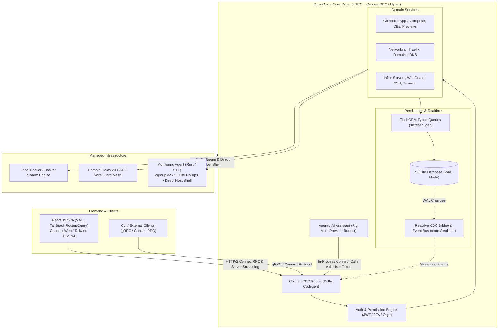
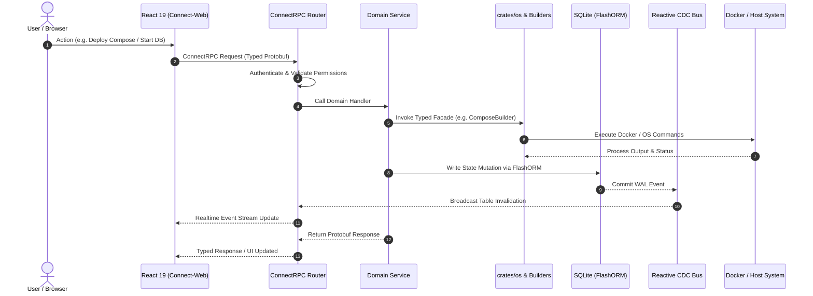
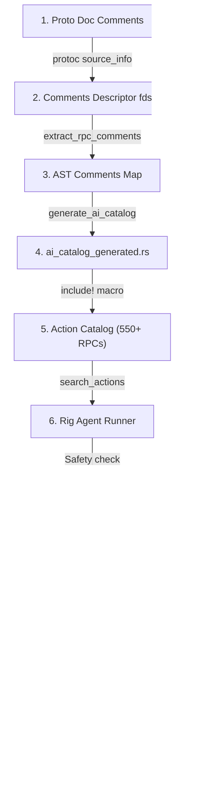
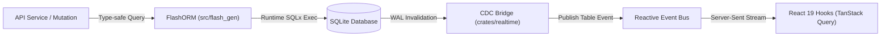

# OpenOxide

OpenOxide is a high-performance, self-hosted infrastructure and application deployment control panel built with **Rust** (nightly, edition 2024), **ConnectRPC / Protobuf**, **React 19**, and a standalone **monitoring agent**. It provides a unified control plane for managing containers, Docker Compose stacks, multi-engine databases, Traefik edge routing, TLS certificates, WireGuard private networks, backups, live host monitoring, and interactive terminal sessions.

OpenOxide also includes an **Agentic AI Assistant** capable of autonomously discovering ~550+ panel operations, searching actions, safely orchestrating resources with explicit confirmation guards, and generating verified Docker Compose stacks from natural language.

---

## Architecture Overview



---

## Main Capabilities

- **Application Orchestration**: Deploy applications from Git repositories (GitHub, GitLab, Gitea, Bitbucket), Dockerfiles, Nixpacks, Railpack, Cloud Native Buildpacks (Paketo), Heroku buildpacks, and static assets.
- **Docker Compose Stacks**: Full Compose lifecycle orchestration, programmatic `ComposeBuilder`, volume mounts, environment variable interpolation, configuration patches, secrets, imports/exports, and isolated preview environments.
- **Multi-Database Management**: Automated provisioning and lifecycle management for PostgreSQL, MySQL, MariaDB, MongoDB, Redis, and LibSQL with native connection builders.
- **Agentic AI Assistant**: Autonomous conversational assistant driven by [Rig](https://github.com/0xPlayground/rig). Automatically extracts ~550+ actions from `.proto` doc comments at build time, performs keyword action discovery, enforces destructive operation confirmations, and executes operations via in-process ConnectRPC endpoints under the user's authentic permissions.
- **AI Stack Generator**: Multi-provider LLM engine (OpenAI, Anthropic Claude, Google Gemini, Ollama, OpenAI-compatible) that generates verified Docker Compose stacks with strict YAML syntax checks, port collision prevention, and security validations.
- **ConnectRPC Contract**: 100% type-safe API communication between backend and frontend powered by Protobuf definitions (`proto/openoxide/api/v1/*.proto`) and Connect-Web.
- **Realtime Reactive CDC Engine**: SQLite change-data-capture (CDC) bridge and event bus (`crates/realtime`) that pushes live database updates straight to frontend TanStack Query hooks without polling.
- **Standalone Monitoring Agent (Rust & C++)**: Deployed once per host. Collects host and container statistics (cgroup v2 / streaming), stores historical rollups in a local SQLite database, and serves historical telemetry to the panel over gRPC.
- **Direct Host Shell**: Agent enters host namespaces (`mnt`, `pid`, `net`) directly with `CAP_SYS_PTRACE`, providing native, frictionless web terminal access to the host.
- **Traefik Edge & TLS**: Automatic Traefik reverse proxy configuration, HTTP/HTTPS routers, middleware chains, rate limiting, and Let's Encrypt / ACME TLS certificate lifecycle.
- **Networking & WireGuard**: Automated WireGuard mesh creation, key rotation, route configuration, and support for external providers (Tailscale, NetBird, ZeroTier).
- **Disaster Recovery**: Automated, scheduled backups for databases, volumes, Compose configurations, and the panel database with S3/Rclone support.

---

## Request & Communication Flow



---

## AI Assistant Architecture

The OpenOxide AI Assistant automatically synchronizes with the API. When an RPC method and leading doc comments are written in `.proto`, the assistant automatically learns the action at build time with zero manual catalog maintenance.



---

## Workspace Layout

```text
openoxide/
├── agent/                         # Standalone Rust monitoring agent (cgroup v2, gRPC, host shell)
├── agent-cpp/                     # Lightweight C++ monitoring agent alternative
├── crates/
│   ├── os/                        # Typed OS, Docker, Git, SSH, WireGuard & DB client builders
│   ├── realtime/                  # SQLite CDC / WAL watcher & reactive event bus
│   ├── sh_macros/                 # Typed shell script macros
│   └── auto/                      # Procedural macros for routing and sockets
├── db/
│   ├── schema/                    # FlashORM schema definitions (*.sql)
│   ├── queries/                   # FlashORM SQL queries (*.sql)
│   └── migrations/                # Ordered runtime SQL migrations
├── proto/                         # Protocol Buffer definitions for ConnectRPC and gRPC
│   └── openoxide/api/v1/          # 40+ panel service contracts (.proto)
├── src/
│   ├── api/                       # ConnectRPC service implementations & HTTP handlers
│   ├── core/                      # Configuration, JWT authentication, permissions, state
│   ├── db/                        # SQLite connection pool and reactive bus wiring
│   ├── flash_gen/                 # Generated FlashORM queries & models (DO NOT EDIT DIRECTLY)
│   ├── services/
│   │   ├── compute/               # Applications, Compose, databases, preview environments
│   │   ├── infrastructure/        # Servers, WireGuard, SSH keys, terminal sessions
│   │   ├── networking/            # Traefik configuration, domains, DNS providers
│   │   ├── platform/              # AI Assistant/Agent, settings, overview, registry
│   │   └── migration/             # Workload and database migration runners
│   └── utils/
│       ├── builder/               # Programmatic ComposeBuilder & database client builders
│       ├── setup/                 # Remote server provisioning and audit workflows
│       └── traefik/               # Dynamic Traefik YAML/file configuration builders
├── web/openoxide_react/            # Modern React 19 SPA (Vite, TanStack, Tailwind v4, Bun)
├── Dockerfile                     # Multi-stage production panel Dockerfile
├── Dockerfile.agent               # Static musl agent container definition
├── docker-compose.dev.yml         # Local Docker development stack
└── justfile                       # Task automation recipes
```

---

## Core Backend Domains

The `src/services` directory houses domain logic:

| Domain | Responsibility |
| --- | --- |
| `compute/application` | Git/Docker deployments, buildpacks, port bindings, mounts, redirects, middleware, rollback |
| `compute/compose` | Compose stack deployment, lifecycle, templating, transfers, and `ComposeBuilder` |
| `compute/database` | PostgreSQL, MySQL, MariaDB, MongoDB, Redis, LibSQL lifecycle and client builders |
| `compute/preview` | Ephemeral preview environment lifecycle, pull-request webhooks, automatic teardown |
| `platform/ai` | Agentic AI Assistant, Rig completion loop, automated catalog discovery, Compose stack generator |
| `platform/realtime` | Streaming database state changes to connected web clients via ConnectRPC |
| `infrastructure/server` | Remote server provisioning, SSH keys, WireGuard private networks, and direct host shell |
| `networking/traefik` | Traefik reverse proxy dynamic config, middlewares, routing rules, health checks |
| `networking/domain` | Custom domains, DNS providers (Cloudflare, Route53, etc.), and ACME SSL certificates |
| `backup` | Scheduled and manual backups for databases, volumes, Compose configs, and panel state |
| `notification` | Multi-channel alert dispatch (Discord, Slack, Telegram, Email, Webhooks, etc.) |

---

## The `crates/os` Infrastructure Layer

`crates/os` provides a strongly-typed, safe facade over low-level system and container operations:

- **Docker & Swarm**: Typed builders for containers, Compose, networks, volumes, Swarm services, and exec sessions.
- **ComposeBuilder**: Programmatic Docker Compose file and stack management with environment variable overrides and volume definitions.
- **Database Client Builders**: Reusable, typed connection builders for MySQL, PostgreSQL, and Redis.
- **Direct Host Shell**: Enters host namespaces (`mnt`, `pid`, `net`) directly for zero-latency interactive terminal sessions from the dashboard.
- **WireGuard**: Typed `wg` and `wg-quick` configuration, key generation, handshake monitoring, and route management.
- **Exec & SSH**: Local and remote command runners with output streaming, host-key verification, and cancel-on-drop semantics.
- **System**: Cgroup v2 resource limits, disk diagnostics, package management, and GPU inspection.

---

## Persistence & Realtime CDC

OpenOxide combines **SQLite**, **FlashORM**, and a **Reactive CDC Bus**:



- **FlashORM (`src/flash_gen/`)**: Query code is generated at development time via `flash gen` (`just gen`) from `db/schema/*.sql` and `db/queries/*.sql`. Generated queries use runtime SQLx (`macros=false`), meaning **`cargo build`, `cargo check`, and `cargo test` do NOT require a live `DATABASE_URL`**.
- **Reactive CDC**: Database writes emit table-level invalidations across the reactive event bus so the dashboard refreshes automatically without polling.

---

## Development & Workflow

### Prerequisites

- **Rust**: Nightly toolchain pinned via `rust-toolchain.toml` (edition 2024).
- **Bun**: Package manager and runtime for the frontend (`web/openoxide_react`). Do not use npm/yarn.
- **Docker**: For local container orchestration and dev stack.
- **Just**: Task runner (`cargo install just`).
- **FlashORM CLI** (optional, only when editing SQL queries): `go install github.com/Lumos-Labs-HQ/flash@latest`.
- **Buf** (optional, only when editing `.proto` files): for ConnectRPC stub generation.

### Common `just` Commands

```bash
# Start full local dev stack (Panel :4000, Agent :50051, Traefik edge :80/443)
just up

# Run panel natively on host (builds web bundle first)
just run

# Run frontend Vite dev server standalone (:3001)
just web

# Instantaneous web redeploy to running dev container without Rust recompile
just web-deploy
just web-deploy-watch

# Regenerate FlashORM query code after editing db/schema or db/queries
just gen

# Tail logs of the dev stack
just logs

# Stop dev stack
just down
```

### Backend Quality Checks

```bash
cargo check --workspace --all-targets
cargo test --workspace
cargo clippy --workspace --all-targets
```

### Frontend Workflow (`web/openoxide_react`)

```bash
cd web/openoxide_react

# Install dependencies (Bun only)
bun install

# Start Vite dev server
bun run dev

# Run type check and oxlint/oxfmt
bun run check:tsc
bun run check:oxc

# Regenerate ConnectRPC stubs from .proto definitions
bun run gen:connect
```

---

## Configuration Reference

Set these environment variables in your `.env` file or container environment.

### Panel Variables

| Variable | Default | Purpose |
| --- | --- | --- |
| `DATABASE_URL` | `sqlite://data/db.sqlite3` | Panel SQLite database location |
| `HOST` | `0.0.0.0` | HTTP bind address |
| `PORT` | `4000` | HTTP listening port |
| `METRICS_TOKEN` | required | Shared authentication token between Panel and Monitoring Agents |
| `SECRET_KEY` | required | Application encryption secret |
| `JWT_ACCESS_SECRET` | required | Secret for signing JWT access tokens |
| `JWT_REFRESH_SECRET` | required | Secret for signing JWT refresh tokens |
| `SOCKET_PATH` | `/var/run/docker.sock` | Local Docker daemon socket |
| `TRAEFIK_BASE_PATH` | `./data/traefik` | Traefik configuration root directory |
| `OPENOXIDE_SERVER_URL` | `http://127.0.0.1:4000` | URL used by agents and remote setup to reach panel |

### Monitoring Agent Variables

| Variable | Default | Purpose |
| --- | --- | --- |
| `SERVER_ID` | `1` | ID of the server record in OpenOxide represented by this agent |
| `METRICS_TOKEN` | required | Must match the panel's `METRICS_TOKEN` |
| `OPENOXIDE_SERVER_URL` | `http://127.0.0.1:4000` | Reachable URL of the OpenOxide panel |
| `GRPC_PORT` | `50051` | Historical telemetry gRPC listening port |
| `REFRESH_RATE` | `60` | Metric collection interval in seconds |
| `RETENTION_DAYS` | `7` | Retention period for local SQLite metrics |
| `COLLECTION_MODE` | `auto` | Metric collector mode: `auto`, `cgroup`, or `stream` |
| `DOCKER_SOCKET` | `/var/run/docker.sock` | Host Docker socket |

---

## Contributing

1. Adhere to **Conventional Commits** (`feat(web):`, `fix(agent):`, `refactor(ai):`).
2. Frontend code must follow `oxfmt` and `oxlint` rules (`bun run format` / `bun run check:oxc`).
3. Never hand-edit files in generated directories (`src/flash_gen/`, `web/openoxide_react/src/gen/`).
4. Run `cargo clippy --workspace --all-targets` and `bun run check:tsc` before submitting changes.
