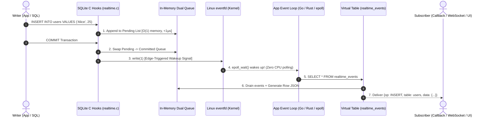

# SQLite Realtime Extension (`ext/realtime`)

A high-performance, transaction-aware Change Data Capture (CDC) and live query subscription extension for SQLite with Linux `eventfd`/`epoll` integration and In-Memory Virtual Table (`realtime_events`).

Designed to run **100% in-process** inside your application without requiring external servers, message brokers, background daemons, or database shadow tables.

---

## 🌟 Key Features

* **⚡ Ultra-Low Latency & In-Memory:**
  * Changes are stored purely in RAM (heap) via connection-private linked lists.
  * **0 bytes extra disk space** — no `_changes_log` shadow tables or database file bloat.
* **🛡️ 100% Transaction & Rollback Safe (ACID):**
  * Mutations during active transactions are held in a private *Pending Buffer*.
  * On `COMMIT`, pending nodes atomically transition to the *Committed Queue*.
  * On `ROLLBACK`, all pending events are immediately discarded (**Zero dirty/phantom events**).
* **🔔 Linux `eventfd` & `epoll` Reactive Wakeup:**
  * Uses `eventfd` strictly as an edge-triggered wakeup signal.
  * **0% CPU usage while idle** — background threads/goroutines sleep in `epoll_wait`.
  * Single wakeup signal per transaction commit regardless of batch size (10k rows = 1 syscall).
* **🌐 Zero-CGo / Pure SQL Virtual Table (`realtime_events`):**
  * Works natively with standard SQLite drivers in **Golang, Rust, Python, Node.js, Java, C#**.
  * No custom C bindings or CGo required on the application side.
* **📋 Ready-to-Use JSON Row Payloads:**
  * Queries on `realtime_events` automatically serialize modified row columns into JSON (`{"id": 1, "name": "Alice", "age": 25}`).

---

## 🏛️ System Architecture



---

## 📦 Directory Layout

```text
ext/realtime/
├── realtime.h         # Public C header & API declarations
├── realtime.c         # Core C extension & realtime_events Virtual Table
├── test_realtime.c    # Standalone C test suite (15 assertions, epoll integration)
├── Makefile           # Build rules for realtime.so and test_realtime
└── README.md          # Complete documentation & usage guide
```

---

## 🛠️ Build & Test

```bash
# 1. Build the shared library (realtime.so) and run test suite:
cd ext/realtime
make test

# 2. Build realtime.so loadable extension only:
make realtime.so
```

---

## 📊 SQL Virtual Table Reference (`realtime_events`)

When loaded as an extension (`.load ./realtime`), the module exposes:

### Functions:
* `SELECT realtime_init();` $\rightarrow$ Initializes realtime tracking and returns the OS `eventfd` descriptor (integer).
* `SELECT realtime_fd();` $\rightarrow$ Returns the active `eventfd` descriptor.

### Virtual Table:
```sql
SELECT op, db_name, table_name, rowid_val, data FROM realtime_events;
```

| Column | Type | Description | Example |
| :--- | :--- | :--- | :--- |
| `op` | `TEXT` | Operation type | `'INSERT'`, `'UPDATE'`, `'DELETE'` |
| `db_name` | `TEXT` | Database name | `'main'` |
| `table_name` | `TEXT` | Target table | `'users'`, `'orders'` |
| `rowid_val` | `INTEGER` | Row Primary Key / ID | `1`, `101` |
| `data` | `TEXT` (JSON) | Full Row JSON payload | `'{"id": 1, "name": "Alice", "age": 25}'` |

*Note: For `DELETE` operations, `data` is returned as `NULL`.*

---

## 💻 Language Examples

### 🐹 1. Golang (Zero-CGo / Pure SQL Driver)

```go
package main

import (
	"database/sql"
	"fmt"
	"os"
	_ "github.com/mattn/go-sqlite3"
)

func main() {
	db, _ := sql.Open("sqlite3", "app.db")
	defer db.Close()

	// 1. Load extension & Initialize
	db.Exec("SELECT load_extension('./ext/realtime/realtime.so')")
	var eventFd int
	db.QueryRow("SELECT realtime_init()").Scan(&eventFd)

	// 2. Listen to eventfd via standard Go os.File (handled by Go netpoller/epoll)
	eventFile := os.NewFile(uintptr(eventFd), "eventfd")
	defer eventFile.Close()

	go func() {
		buf := make([]byte, 8)
		for {
			eventFile.Read(buf) // Wakes up on COMMIT (0% CPU while sleeping)

			// 3. Drain via standard SQL query!
			rows, _ := db.Query("SELECT op, table_name, rowid_val, data FROM realtime_events;")
			for rows.Next() {
				var op, table string
				var rowID int64
				var data sql.NullString
				rows.Scan(&op, &table, &rowID, &data)

				fmt.Printf("🔔 [Live Event] %s on %s (ID: %d) -> Payload: %s\n",
					op, table, rowID, data.String)
			}
			rows.Close()
		}
	}()
}
```

---

### 🦀 2. Rust (Tokio Async + `rusqlite`)

```rust
use rusqlite::{Connection, Result};
use std::os::unix::io::RawFd;
use tokio::io::unix::AsyncFd;

#[tokio::main]
async fn main() -> Result<()> {
    let conn = Connection::open("app.db")?;

    // 1. Initialize via SQL
    conn.load_extension("./ext/realtime/realtime.so", None)?;
    let event_fd: RawFd = conn.query_row("SELECT realtime_init()", [], |r| r.get(0))?;

    // 2. Wrap in Tokio AsyncFd (Attaches to Tokio's internal epoll)
    let async_fd = AsyncFd::new(event_fd).unwrap();

    tokio::spawn(async move {
        loop {
            let mut guard = async_fd.readable().await.unwrap();

            // 3. Drain via SQL
            let mut stmt = conn.prepare("SELECT op, table_name, rowid_val, data FROM realtime_events;").unwrap();
            let mut rows = stmt.query([]).unwrap();
            while let Some(row) = rows.next().unwrap() {
                let op: String = row.get(0).unwrap();
                let table: String = row.get(1).unwrap();
                let data: Option<String> = row.get(3).unwrap();
                println!("🔔 [Rust Live Event] {} on {} -> {:?}", op, table, data);
            }
            guard.clear_ready();
        }
    });

    Ok(())
}
```

---

## ⚖️ Pros & Cons

| Pros (Strengths) | Cons & Trade-offs |
| :--- | :--- |
| ⚡ **Microsecond latency** (In-memory event dispatching) | ⚠️ **In-memory queue** (Volatile across process crashes, requires initial baseline query) |
| 💤 **Zero polling** & 0% CPU consumption while idle | 🐧 **Linux-native** (`eventfd` requires fallback on Windows/macOS) |
| 📦 **Zero disk bloat** (0 KB added to database file) | 💻 **In-process scope** (Shared across threads/goroutines within the same app process) |
| 🛡️ **100% Rollback-safe** (No phantom/dirty read events) | 🗑️ **DELETE payload** (Data column is null upon row deletion) |
| 🌐 **Pure SQL interface** (Zero C bindings needed in Go/Rust/Python) | 🧠 **Batch memory** (Huge 5M+ row batch transactions hold nodes in RAM until drain) |
