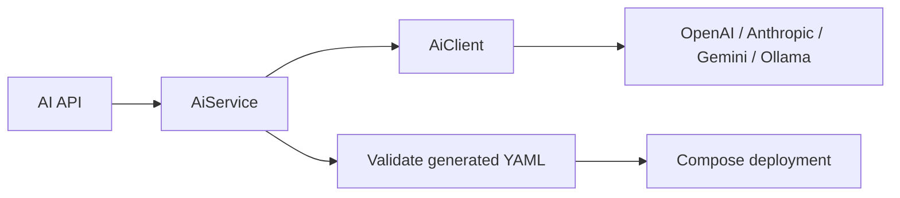
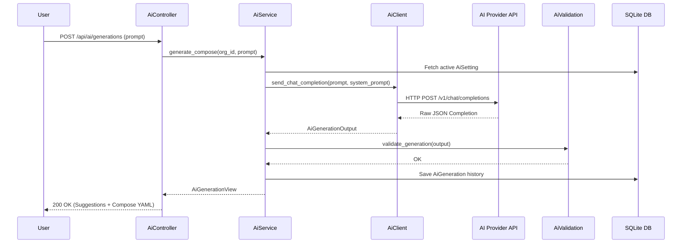
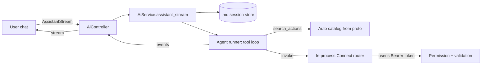

# OpenOxide AI Service Architecture

```text
┌─ AI REQUEST ─────────────────────────────────────────────┐
│ API → AiService → provider client → validation → compose │
│ Scope: organization + application                         │
│ Safety: YAML/port validation before deployment            │
└───────────────────────────────────────────────────────────┘
```



OpenOxide provides a multi-provider, organization-scoped **AI Engine** designed to generate Docker Compose stacks, diagnose build/runtime errors, and perform one-click AI application deployments.

---

## 1. Architecture Overview

```
                          ┌───────────────────────┐
                          │   Axum Controller     │
                          │ (/api/ai/generations) │
                          └───────────┬───────────┘
                                      │
                                      ▼
                          ┌───────────────────────┐
                          │       AiService       │
                          └───────────┬───────────┘
                                      │
           ┌──────────────────────────┼──────────────────────────┐
           ▼                          ▼                          ▼
┌────────────────────┐     ┌────────────────────┐     ┌────────────────────┐
│   AiClient         │     │  AiValidation      │     │  ComposeService    │
│ (HTTP Provider SDK)│     │ (YAML/Port Guard)  │     │ (Deployment Engine)│
└──────────┬─────────┘     └────────────────────┘     └────────────────────┘
           │
           ├──────────────────────────┬──────────────────────────┬──────────────────────────┐
           ▼                          ▼                          ▼                          ▼
  ┌─────────────────┐        ┌─────────────────┐        ┌─────────────────┐        ┌─────────────────┐
  │     OpenAI      │        │    Anthropic    │        │  Google Gemini  │        │  Ollama / Local │
  └─────────────────┘        └─────────────────┘        └─────────────────┘        └─────────────────┘
```

---

## 2. Detailed Internal Working Mechanism

The AI Service operates through a strict 5-phase async pipeline:

```
[1. Prompt Ingestion]  ──► Natural Language Prompt + System Prompt Assembly
                             │
[2. Provider Detect]   ──► AiProviderKind Detection (OpenAI / Anthropic / Gemini / Ollama)
                             │
[3. Completion Dispatch]──► HTTP Chat Completion API Request ──► Raw Response Parsing
                             │
[4. Security Guard]    ──► YAML Syntax Check ──► Host Mount / Port / Env Validation
                             │
[5. One-Click Deploy]  ──► DB History Saved ──► Auto-Provision Compose Project & Deploy
```

### Phase 1: Prompt Ingestion & Context Assembly (`prompts.rs`)
1. Receives natural language user query (e.g. *"Deploy a Django app with PostgreSQL and Redis"*).
2. `prompts.rs` injects system prompt constraints demanding strict JSON output schemas (`AiGenerationOutput`).

### Phase 2: Provider Auto-Detection & Config (`provider.rs`)
1. `AiProviderKind::detect` inspects the target API URL:
   - `anthropic.com` $\rightarrow$ Anthropic Claude Messages API.
   - `generativelanguage.googleapis.com` $\rightarrow$ Google Gemini API.
   - `localhost:11434` / `ollama` $\rightarrow$ Ollama Local Native API.
   - `api.openai.com` / custom $\rightarrow$ OpenAI Chat Completions API.

### Phase 3: Completion Dispatch & Response Parsing (`client.rs`)
1. Sends authenticated HTTP POST request to the provider's completion endpoint.
2. Extracts JSON output string and parses it into structured structs:
   - `AiComposeSuggestion`: Generated `docker-compose.yml`, extracted environment variables (`AiEnvironmentVariable`), domain routes (`AiDomain`), and configuration files (`AiGeneratedFile`).

### Phase 4: Strict Security & Syntax Validation (`validation.rs`)
Before any AI output is accepted:
1. **YAML Verification**: Parses YAML with `serde_yaml` to prevent syntax crashes.
2. **Security Guard**: Rejects dangerous host bind mounts (`/var/run/docker.sock`, `/etc`, `/usr`).
3. **Port & Env Checking**: Verifies port formats and ensures all referenced environment variables are defined.

### Phase 5: One-Click Compose Deployment Automation (`service.rs`)
1. Saves query history to SQLite `ai_generations` table.
2. When user clicks **"Deploy AI Stack"**:
   - Creates a new Compose Project in the target environment via `ComposeService::create`.
   - Provisions domain routes (`DomainService`) and volume mounts.
   - Triggers automatic background deployment (`ComposeOperation::Deploy`).

---

## 3. Multi-Provider Support (`AiProviderKind`)

OpenOxide automatically detects provider types based on URL patterns:

- **OpenAI**: `https://api.openai.com` (`gpt-4o`, `gpt-4o-mini`).
- **Anthropic**: `https://api.anthropic.com` (`claude-3-5-sonnet`, `claude-3-haiku`).
- **Google Gemini**: `https://generativelanguage.googleapis.com` (`gemini-1.5-pro`, `gemini-1.5-flash`).
- **Ollama**: `http://localhost:11434` or custom Ollama URL (Self-hosted local AI models like `llama3`, `mistral`, `deepseek-r1`).
- **OpenAI-Compatible**: Any custom endpoint implementing OpenAI Chat Completions (Groq, Together.ai, OpenRouter, vLLM, LocalAI).

---

## 4. Core AI Capabilities

### 4.1 AI Stack Generation (`generate_compose`)
Converts natural language user prompts into structured infrastructure:
- Validated `docker-compose.yml` string.
- Extracted Environment Variables (`AiEnvironmentVariable`).
- Domain Routing Configurations (`AiDomain`).
- Additional Config Files (`AiGeneratedFile`).

### 4.2 Log Analysis & Error Diagnosis (`analyze_logs`)
Analyzes raw logs to detect failure root causes and suggest fix steps:
- **Build Logs (`AiLogContext::Build`)**: Diagnoses Dockerfile syntax errors, missing dependencies, or compile failures.
- **Runtime Logs (`AiLogContext::Runtime`)**: Diagnoses database connection timeouts, memory OOM crashes, or port binding issues.

### 4.3 One-Click AI Deploy (`deploy_suggestion`)
Converts an AI suggestion into a live deployment:
1. Validates generated Compose YAML and environment variables.
2. Creates a Compose Project in the database (`ComposeService::create`).
3. Provisions required domain routes and volume mounts.
4. Triggers automatic background deployment (`ComposeOperation::Deploy`).

---

## 5. Strict Validation & Security (`validation.rs`)

Before any AI-generated stack is accepted or deployed, it passes through strict security and syntax validation:

1. **YAML Syntax Verification**: Parses generated YAML using `serde_yaml` to prevent malformed syntax.
2. **Dangerous Mount Protection**: Blocks host mount paths that jeopardize server security (e.g., `/var/run/docker.sock`, `/etc`, `/usr`).
3. **Port Binding Validation**: Verifies host and container port formats.
4. **Environment Variable Reference Check**: Ensures all referenced environment variables are defined.

---

## 6. Database Schema & Models

### 6.1 `ai_settings` Table
Stores organization-scoped provider configurations.
- `id` (INTEGER PRIMARY KEY)
- `name` (TEXT NOT NULL): Display label (e.g., "Production Claude 3.5").
- `api_url` (TEXT NOT NULL): Endpoint URL.
- `api_key` (TEXT NOT NULL): Encrypted API Key.
- `model` (TEXT NOT NULL): Target model identifier (e.g., `gpt-4o`).
- `is_enabled` (INTEGER DEFAULT 1): Active status.
- `organization_id` (INTEGER REFERENCES organization(id)).

### 6.2 `ai_generations` Table
Stores historical prompt outputs and deployment tracking.
- `id` (INTEGER PRIMARY KEY)
- `ai_setting_id` (INTEGER REFERENCES ai_settings(id))
- `organization_id` (INTEGER REFERENCES organization(id))
- `created_by` (INTEGER REFERENCES users(id))
- `prompt` (TEXT NOT NULL): Original user query.
- `output` (TEXT NOT NULL): JSON-serialized `AiGenerationOutput`.
- `status` (TEXT NOT NULL): `'PENDING'`, `'COMPLETED'`, `'FAILED'`.
- `compose_id` (INTEGER NULLABLE REFERENCES compose_projects(id)).

---

## 7. Request Sequence Diagram

## 8. How the AI layer is implemented

OpenOxide uses Rig as the provider abstraction rather than hand-writing each raw completion protocol. `AiClient` selects the configured provider/base URL/model and builds the corresponding Rig client. Organization-scoped settings and generations are read/written through repositories.

Model output is treated as untrusted text. Compose extraction removes prose/code fences, parses YAML, validates service structure and exposed ports, and only then hands the suggestion to `ComposeService`. Deploying an AI suggestion therefore uses the same permission, persistence, queue, remote execution, logging, and cancellation path as a manually authored Compose project.

Provider/network errors remain generation failures and cannot mutate deployment state before validation succeeds.




---

# OpenOxide Agentic AI Assistant

> This section documents the **conversational agent** (the "AI Assistant" chat
> in the dashboard). It is separate from the compose-generation engine above:
> the assistant turns natural-language requests ("deploy blinko", "stop the
> staging db", "what projects do I have?") into **permission-checked panel
> actions**, executed in-process and streamed live.



## 1. What it is

- A multi-step agent driven by the configured AI provider (same providers as
  the generation engine: OpenAI, Anthropic, Gemini, Ollama, OpenAI-compatible).
- It discovers what it can do by **searching an auto-generated action catalog**
  (every unary RPC across all 40+ panel services — ~550 actions), and executes
  chosen actions by calling the panel's **own Connect endpoints in-process**
  with the **caller's own Bearer token**. So the agent can only ever do what the
  user could do manually — same auth, permission, validation, and audit path.
- Progress **streams live** (thinking → searching → running action → result →
  reply), and conversation history is kept **server-side** so the web only
  sends a `session_id`.

## 2. The tool loop

The runner (`services/platform/ai/agent/runner.rs`) drives the provider's
completion API by hand with a small, fixed tool set:

| Tool | Purpose |
|------|---------|
| `search_actions(query)` | Keyword-search the catalog for the few relevant actions + their params. The model never sees all ~550 up front. |
| `invoke(action, params, confirmed?)` | Run one action via the in-process Connect router. Destructive actions require `confirmed=true`. |
| `confirm_action(summary, actions[])` | Ask the user Yes/No before destructive actions; the exact actions to run are carried so "yes" executes them deterministically. |
| `choose(question, options[])` | Ask the user to pick one of several options (projects, servers, enum values) — rendered as cards. A `Cancel` option is always appended. |
| `ask_user(question)` | Free-text clarifying question when info is missing. |
| `list_templates` / `install_template` | One-click app templates fetched from the template registry (never hand-written compose YAML). |

Behavioral rules the agent follows (encoded in the system preamble):

- **Chat vs action:** pure questions/greetings/concepts are answered directly
  with **no tools**. Tools only fire when the user wants to look up or change
  their own resources.
- **Vague/beginner requests** ("make blinko work", "fix it") → clarify with
  `choose`/`ask_user` instead of trial-and-error.
- **Required vs optional params:** the catalog marks each param `name!`
  (required) or `name?` (optional); enum params list their valid literals. The
  agent must supply required params (resolving ids via list actions, asking only
  when genuinely unknown).
- **Destructive actions** (stop/delete/reset/…) always confirm first.
- Replies mirror the user's language/script (Hinglish stays Hinglish).

## 3. The action catalog (auto-generated, zero manual list)

`build.rs::generate_ai_catalog()` reads the compiled proto **descriptor set**
and emits `ai_catalog_generated.rs` with a `GeneratedAction { name,
connect_path, description, params }` for **every unary RPC**:

- `name` — snake_case id, e.g. `compose_deploy`.
- `connect_path` — `openoxide.api.v1.ComposeService/Deploy`.
- `params` — derived from the request message's fields, each marked `!`/`?`
  (required/optional) with enum values inlined, e.g.
  `{ id!:number, env_var?:string }`.
- `description` — **the proto `//` comment above the rpc** (a second protoc pass
  with `--include_source_info` extracts them, since connectrpc strips comments
  from its own descriptor). No comment → a generic fallback.

**To improve an action's guidance, edit its `//` comment in the `.proto`** — the
catalog picks it up on the next build. Adding a new RPC automatically adds an
assistant action.

## 4. Streaming protocol

`rpc AssistantStream(AiAssistantRequest) returns (stream AiAssistantEvent)`.

Each `AiAssistantEvent` has a `kind`:

- `THINKING` / `STATUS` — progress lines (searching, running X…).
- `ACTION_RESULT` — short result summary.
- `REPLY` — the final text answer.
- `INTERACTION` — a structured `AiInteraction` (CONFIRM or CHOICE) the UI renders
  as a Yes/No bar or option cards above the input.
- `DONE` — terminal; `session_id` is always present.

The web (`ai-chat-sheet.tsx`) consumes the stream with `for await`, shows live
steps, renders the reply as markdown, and surfaces interactions in a dedicated
panel. The panel server enables **HTTP/2 keepalive** so long multi-step turns
are not dropped mid-stream.

## 5. Sessions (server-side history)

The web sends only a `session_id`; the server keeps the transcript in a
markdown file per session at `/app/data/ai-sessions/{session_id}.md`
(`agent/session.rs`):

- Each turn is appended as a `## user` / `## assistant` block (background,
  non-blocking).
- On the next request the server reads the file and feeds a **sliding window**
  (last ~15 turns, ≤ ~60k tokens) to the model.
- Older turns are kept on disk; when history exceeds the budget it is compacted
  into a `## summary` block + the recent window.
- Sessions older than 7 days are eligible for cleanup.
- The "New chat" button in the UI starts a fresh `session_id`.

## 6. Configuration (what you must set up)

The assistant reuses the **same provider settings** as the generation engine —
there is no separate configuration.

1. **Add an AI provider** (dashboard → AI Providers, or `AiService.CreateSettings`):
   - `name` — any label.
   - `api_url` — the provider base URL. Detection is by URL:
     - OpenAI: `https://api.openai.com/v1`
     - Anthropic: `https://api.anthropic.com`
     - Gemini: `https://generativelanguage.googleapis.com/v1beta`
       (the client strips the trailing `/v1beta` because the Gemini SDK re-adds it)
     - Ollama: `http://host:11434`
     - OpenAI-compatible gateways (Groq, OpenRouter, AgentRouter, vLLM, …): their base URL
   - `api_key` — provider key.
   - `model` — must support **function/tool calling** (the agent is tool-driven).
     Known-good: `gpt-4o`, `gpt-4o-mini`, newer OpenAI reasoning models, Claude
     3.5, Gemini 1.5+, tool-capable Ollama models.
   - `is_enabled` — enable it. The assistant uses the org's first enabled
     provider unless the UI picks a specific one.
2. **Verify** with "Discover models" / "Test connection" (`DiscoverModels`,
   `TestConnection`).
3. Open the **AI Assistant** chat (Sparkles icon in the top bar) and start.

No extra env vars are required. The session store writes under the existing
`/app/data` volume.

### Provider quirks handled automatically

- **`max_tokens` vs `max_completion_tokens`:** newer OpenAI reasoning models
  reject `max_tokens`; the runner retries the turn with `max_completion_tokens`.
- **`reasoning_effort` + tools:** models like `gpt-6-sol` reject function tools
  unless `reasoning_effort: "none"`; the runner retries with it set.
- **AgentRouter-style gateways** return 401 to generic clients unless the
  request carries a `QwenCode` User-Agent — the client adds it for
  `*agentrouter*` hosts.
- **Gemini double `/v1beta`** in the URL is stripped so clones/completions hit
  the right path.

## 7. Security model

- Every action the agent runs goes through the **in-process Connect router**
  with the **user's own Bearer token** — the `#[permission(...)]` checks run
  inside each handler exactly as for a real API call. The agent cannot exceed
  the user's permissions, and all actions are audited like manual calls.
- The agent never fabricates compose YAML for templates; it installs the real
  registry template content server-side.
- Model output is untrusted: ids/params are validated by the normal
  request-validation layer; destructive actions require explicit confirmation.

## 8. Troubleshooting

| Symptom | Cause / fix |
|---------|-------------|
| "no enabled AI provider is configured" | Enable a provider in AI Providers for the org. |
| 401 `unauthorized_client` from the provider | The model/gateway rejects the key or needs a specific client UA (AgentRouter). Verify the key with Test Connection. |
| 400 "max_tokens not supported" | Newer reasoning model — handled by auto-retry; if it persists, the gateway may not support `max_completion_tokens`. |
| 404 on Gemini discover/test | Ensure `api_url` is `…/v1beta` (the client normalizes it). |
| "Failed to fetch" mid-chat | Long turn dropped by an idle connection — fixed via server h2 keepalive; if it recurs, a proxy in front may need keepalive too. |
| Assistant calls tools for a plain question | Rephrase; the preamble classifies chat vs action, but ambiguous phrasing can still trigger a lookup. |
| Deploy fails: "Cannot access repository … private or does not exist" | The Git repo is private or the URL is wrong — connect a Git provider or fix the URL/branch. |
| Build fails on a template/app | Buildpacks need a `package.json`/`Dockerfile`; a bare script repo has no build plan. |

## 9. Key source files

- `src/services/platform/ai/agent/runner.rs` — the tool loop, events, preamble.
- `src/services/platform/ai/agent/catalog.rs` — catalog lookup + `search`.
- `src/services/platform/ai/agent/invoke.rs` — in-process Connect dispatch + registered-route filtering.
- `src/services/platform/ai/agent/session.rs` — markdown session store + compaction.
- `src/services/platform/ai/agent/templates.rs` — template registry fetch.
- `src/services/platform/ai/agent/mod.rs` — per-provider model build + `run_assistant`.
- `src/services/platform/ai/service.rs` — `assistant` / `assistant_stream`.
- `src/api/handlers/ai/controller.rs` — `Assistant` / `AssistantStream` RPC wiring.
- `build.rs` — catalog + proto-comment description generation.
- `web/openoxide_react/src/components/ai/assistant/ai-chat-sheet.tsx` — the chat UI.
- `web/openoxide_react/src/api/live/ai.ts` — `streamAssistant` client.
